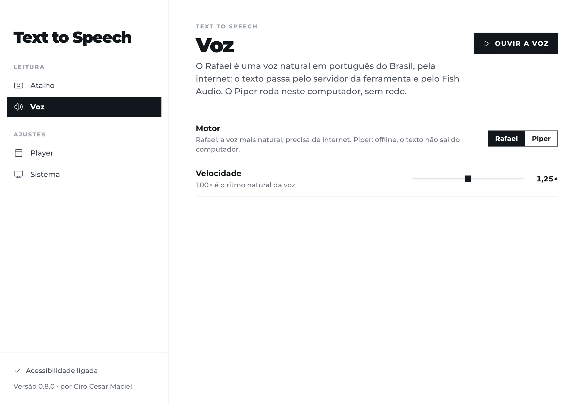

# Text to Speech by Ciro Cesar Maciel

**Select text in any Mac app, press one shortcut, and hear it read aloud.**

One of [six free, open-source Mac apps](#more-from-ciro-cesar-maciel) by [Ciro Cesar Maciel](https://ciromaciel.click/?ref=oss-text-to-speech).

Two voices: Rafael, a natural Brazilian Portuguese voice from [Fish Audio](https://fish.audio), over the internet; or [Piper](https://github.com/rhasspy/piper), which runs on your Mac with no network at all. A small floating player shows the word being spoken and goes away when the reading ends. No account, no telemetry. A menu bar app built with Tauri and Rust.

[Português](README.pt-BR.md)



## Install

```bash
curl -fsSL https://blob.ciromaciel.click/tools/text-to-speech/install.sh | bash
```

The script downloads the latest `.dmg`, copies Text to Speech to `/Applications` and opens it.

Prefer the disk image? [Download Text-to-Speech-macos.dmg](https://blob.ciromaciel.click/tools/text-to-speech/latest/Text-to-Speech-macos.dmg). Open it and drag Text to Speech to Applications. It is signed with Developer ID and notarized by Apple, so macOS opens it with no warning.

The app asks for one permission, **Accessibility**: reading the selection sends Cmd + C to the app in front, and macOS only allows that to a trusted app.

## How it works

1. Select text anywhere: an e-mail, a PDF, a web page, a document.
2. Press **Cmd + Shift + S**. The app copies the selection, puts your clipboard back the way it was, and starts reading.
3. Listen. The player floats on a corner of the screen and closes when the reading ends.

| Key | What it does |
| --- | --- |
| Cmd + Shift + S | Read the selection. Can be changed in the settings window |
| Esc | Stop |
| Space | Pause and resume (player in focus) |
| Left / Right arrow | Back or forward one part |
| - / + | Slower or faster |

The text is read in parts, whole paragraphs where it can, so the voice keeps the sense of what it reads. The first part is short, so the voice starts in a few seconds even on a long text.

## Privacy: what goes where

| Voice | Where the text goes |
| --- | --- |
| **Rafael** (default) | Each part of the text you selected, and the speed, go over HTTPS to the Text to Speech server (`manager.ciromaciel.click`, the same one the web page at [ciromaciel.click/tools/text-to-speech](https://ciromaciel.click/tools/text-to-speech?ref=oss-text-to-speech) uses). The server sends it to Fish Audio, which makes the audio, and returns the MP3 with the time of each word. The server does not store the text. The app holds no API key |
| **Piper** | Nowhere. The voice runs on your Mac. The voice model (about 63 MB) is downloaded once from Hugging Face when you choose Piper |

Nothing else leaves your Mac: the interface font is bundled, there is no analytics, no account and no update check. The settings live in `~/Library/Application Support/click.ciromaciel.text-to-speech/config.json`.

### Use your own server

The internet voice calls `POST <server>/speak-timed` with `{ "text": "...", "speed": 1.0 }` and expects `{ "audio": "<base64 MP3>", "words": [{ "text", "start", "end" }] }` (`words` may be empty). To point the app at a server of your own, add a line to `config.json`:

```json
"server_url": "https://your-server.example/text-to-speech"
```

or set `TEXT_TO_SPEECH_SERVER` in the environment of the app. With neither, the app uses the public server.

## Build it yourself

You need the Xcode Command Line Tools, [Rust](https://rustup.rs), [Bun](https://bun.sh) and CMake (`brew install cmake`, for Piper's espeak-ng).

```bash
git clone https://github.com/ciro-maciel/text-to-speech.git
cd text-to-speech
bun install
bun run dev                  # or: bun run build → /tmp/tts-target/release/bundle
bun test src                 # how a text becomes parts, and the word timing
```

The Rust build goes to `/tmp/tts-target` (`src-tauri/.cargo/config.toml`): espeak-ng, compiled from source for Piper, fails on long paths.

Check that a build reads aloud with both voices, with no window and without touching your settings:

```bash
"/tmp/tts-target/release/bundle/macos/Text to Speech.app/Contents/MacOS/text-to-speech" --self-test /tmp/tts-check
afplay /tmp/tts-check/rafael.mp3 && afplay /tmp/tts-check/piper.wav
```

A local build is signed ad hoc, so macOS asks for Accessibility again after each rebuild. The official build is signed with Developer ID (`scripts/release/build-mac.sh`).

## Limits

- Published for macOS 11 or newer on Apple Silicon only. The code is Tauri and the Rust side compiles elsewhere, but reading the selection is written for macOS only.
- Both voices speak Brazilian Portuguese: text in another language is read with a Portuguese accent. The interface is in English and Brazilian Portuguese, following the Mac's language.
- The internet voice depends on the public server and on Fish Audio; when either is busy, a part can fail. Piper always works offline.

## Contributing

Issues and pull requests are welcome. See [CONTRIBUTING.md](CONTRIBUTING.md).

## License

[MIT](LICENSE). Piper, espeak-ng, the Piper voice, Montserrat and the icons keep their own licenses: see [NOTICE](NOTICE).

---

## More from Ciro Cesar Maciel

I build software on my own, with a team of AI agents, and open what I can. These are six native Mac apps, all free, MIT, signed and notarized by Apple, in English and Brazilian Portuguese:

| App | What it does |
| --- | --- |
| [Cleaner](https://github.com/ciro-maciel/cleaner) | The Mac cleaner that shows you everything before it deletes anything |
| [Screenshots](https://github.com/ciro-maciel/screenshots) | Capture, annotate and record the screen, with nothing leaving your Mac |
| [Speech to Text](https://github.com/ciro-maciel/speech-to-text) | Dictation by shortcut, with Whisper running on your Mac |
| [Assistant](https://github.com/ciro-maciel/voice-assistant) | Claude Code by voice: say its name, ask, hear the answer |
| [Windows](https://github.com/ciro-maciel/windows) | Snap windows into place with a shortcut or by dragging them to the edge |
| [Text to Speech](https://github.com/ciro-maciel/text-to-speech) | Select text in any app and hear it read aloud · **this one** |

Beyond the apps: [free tools for the browser](https://ciromaciel.click/tools?ref=oss-text-to-speech), [books](https://ciromaciel.click/books?ref=oss-text-to-speech), and [Infrastructure](https://myinfrastructure.click/?ref=oss-text-to-speech), the infrastructure AI agents already know how to run.

**Follow along.** [Follow @ciro-maciel](https://github.com/ciro-maciel) for the next open-source apps, click **Watch → Custom → Releases** above for every new version, and see how it is all made on [YouTube](https://www.youtube.com/@ciro-maciel) and at [ciromaciel.click](https://ciromaciel.click/?ref=oss-text-to-speech).
