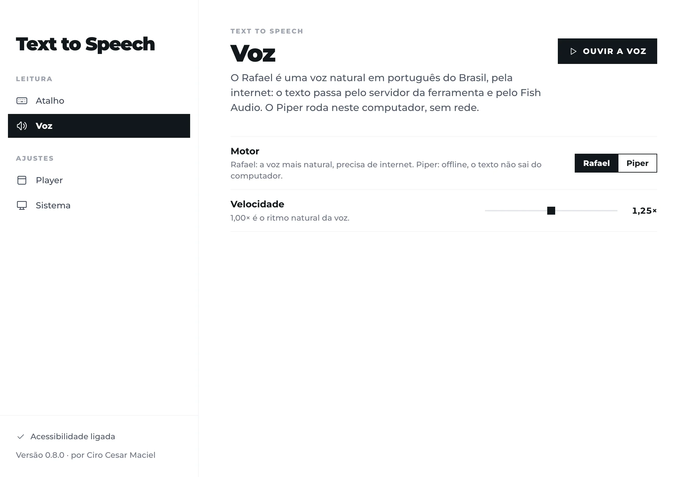

# Text to Speech by Ciro Cesar Maciel

**Select text in any Mac app, press one shortcut, and hear it read aloud.**

One of [six free, open-source Mac apps](#more-from-ciro-cesar-maciel) by [Ciro Cesar Maciel](https://ciromaciel.click/?ref=oss-text-to-speech).

**[Watch the 1-minute video](https://youtu.be/EqDHxP9jKp4)**

[](https://www.opensourcealternatives.to) [](https://alternativeto.net/software/text-to-speech-by-ciro-cesar-maciel/about/?utm_source=badge&utm_medium=referral)

You choose who reads: **Davi**, from [Phonon](https://huggingface.co/gradium/phonon-40m-pt), who runs on your Mac and sends nothing out once the voice is downloaded, or **Rafael**, from [Fish Audio](https://fish.audio), over the internet, with your own key. A small floating player shows the word being spoken and goes away when the reading ends. No account with us, no telemetry. A native menu bar app in Swift: 25 MB on disk; Davi uses about 170 MB of memory only while making a part.

[Português](README.pt-BR.md)



## Install

```bash
curl -fsSL https://blob.ciromaciel.click/tools/text-to-speech/install.sh | bash
```

The script downloads the latest `.dmg`, copies Text to Speech to `/Applications` and opens it.

Prefer the disk image? [Download Text-to-Speech-macos.dmg](https://blob.ciromaciel.click/tools/text-to-speech/latest/Text-to-Speech-macos.dmg). Open it and drag Text to Speech to Applications. It is signed with Developer ID and notarized by Apple, so macOS opens it with no warning.

The app asks for one permission, **Accessibility**: reading the selection sends Cmd + C to the app in front, and macOS only allows that to a trusted app.

## How it works

1. Select text anywhere: an e-mail, a PDF, a web page, a document.
2. Press **Cmd + Shift + S**. The app copies the selection, puts your clipboard back the way it was, and starts reading.
3. Listen. The player floats on the screen and closes when the reading ends.

| Key | What it does |
| --- | --- |
| Cmd + Shift + S | Read the selection. Can be changed in the settings window |
| Esc | Stop |
| Space | Pause and resume |
| Left / Right arrow | Back or forward one part |
| - / + | Slower or faster |

The text is read in parts, whole paragraphs where it can, so the voice keeps the sense of what it reads. The first part is short, and its audio plays while it still arrives, so the voice starts in under a second even on a long text.

## The two voices

The **Voice** pane shows the steps for each, with buttons that open the right pages.

**Davi, on your Mac (Phonon).** The app ships Gradium's `ptts` command and runs Phonon's Brazilian Portuguese model in 4 bits. To turn it on:

1. Create a free account at [huggingface.co](https://huggingface.co).
2. Open the [model page](https://huggingface.co/gradium/phonon-40m-pt) and request access; approval is automatic.
3. Create a [Read token](https://huggingface.co/settings/tokens/new?tokenType=read) and paste it in **Voice**.

On the first reading the app downloads the voice once (58 MB). The model is Gradium's, under [CC BY-NC 4.0](https://creativecommons.org/licenses/by-nc/4.0/): personal, non-commercial use, which you accept on Hugging Face. The Davi voice is from Gradium's catalog, Apache-2.0.

**Rafael, over the internet (Fish Audio).** The app calls Fish Audio directly, with your key:

1. Create an account at [fish.audio](https://fish.audio).
2. Open [API keys](https://fish.audio/app/api-keys/) and create one.
3. Paste the key in **Voice**.

Fish's free model ends on 30 November 2026; after that Fish bills the use to your account.

## Privacy: what goes where

- **Davi:** the text never leaves the Mac. The only network call is the voice download, once, from Hugging Face, with your token.
- **Rafael:** each part of the text you selected, and the speed, go over HTTPS straight to Fish Audio, on your account, which sends back the MP3 and the time of each word.

The Fish key and the Hugging Face token stay in the macOS keychain, on your Mac only. Nothing else leaves your Mac: the interface font ships inside the app, and there are no analytics, no account and no update check.

## Build it yourself

You need macOS 14 or later on Apple Silicon and the Xcode Command Line Tools (Swift 5.10 or later).

```bash
git clone https://github.com/ciro-maciel/text-to-speech.git
cd text-to-speech
scripts/build.sh             # → dist/Text to Speech.app
scripts/check.sh             # the reading logic, then a short reading out loud with each voice that has a key
```

Without a Developer ID certificate the build is signed ad hoc, so macOS asks for Accessibility again after each rebuild. `scripts/dist.sh` bumps the version, builds, packs the `.dmg`, has Apple notarize it (keychain profile `notary`) and installs it.

## Limits

- macOS 14 or newer on Apple Silicon.
- Both voices speak Brazilian Portuguese: text in another language is read with a Portuguese accent. The interface is in English and Brazilian Portuguese, following the Mac's language.
- Davi doesn't report the time of each word: the player's highlight is estimated from the text. Rafael highlights the exact word.
- Rafael depends on Fish Audio; when it is busy, a part can fail.
- No automatic updates yet: install the new version the same way as the first.

## Contributing

Issues and pull requests are welcome. See [CONTRIBUTING.md](CONTRIBUTING.md).

## License

[MIT](LICENSE). Montserrat and the icons keep their own licenses: see [NOTICE](NOTICE).

---

## More from Ciro Cesar Maciel

I build software on my own, with a team of AI agents, and open what I can. Six native Mac apps, all free, MIT, signed and notarized by Apple, in English and Brazilian Portuguese: [Cleaner](https://github.com/ciro-maciel/cleaner), the Mac cleaner that shows you everything before it deletes anything · [Screenshots](https://github.com/ciro-maciel/screenshots), capture, annotate and record the screen, with nothing leaving your Mac · [Speech to Text](https://github.com/ciro-maciel/speech-to-text), dictation by shortcut, with Parakeet running on your Mac · [Assistant](https://github.com/ciro-maciel/voice-assistant), Claude Code by voice · [Windows](https://github.com/ciro-maciel/windows), snap windows into place with a shortcut or by dragging them to the edge · [Text to Speech](https://github.com/ciro-maciel/text-to-speech), select text in any app and hear it read aloud (this one).

Beyond the apps: [free tools for the browser](https://ciromaciel.click/tools?ref=oss-text-to-speech), [books](https://ciromaciel.click/books?ref=oss-text-to-speech), and [Infrastructure](https://myinfrastructure.click/?ref=oss-text-to-speech), the infrastructure AI agents already know how to run.

**Curated lists.** [Nineteen awesome lists](https://go.mymarketing.click/oss-text-to-speech-listas) in Brazilian Portuguese, translated into 14 languages: AI at work by profession, Pix, NF-e, payments, Open Finance, WhatsApp, Brazilian APIs, MCP servers, Claude Code and more. Every link was opened before it went in.

**Support.** Everything here is free and stays free. If it saved you time, [buy me a coffee](https://go.mymarketing.click/oss-text-to-speech-apoie): you choose the amount, by Pix or card.

**Follow along.** [Follow @ciro-maciel](https://github.com/ciro-maciel) for the next open-source apps, click **Watch → Custom → Releases** above for every new version, and see how it is all made on [YouTube](https://www.youtube.com/@ciro-maciel) and at [ciromaciel.click](https://ciromaciel.click/?ref=oss-text-to-speech).
