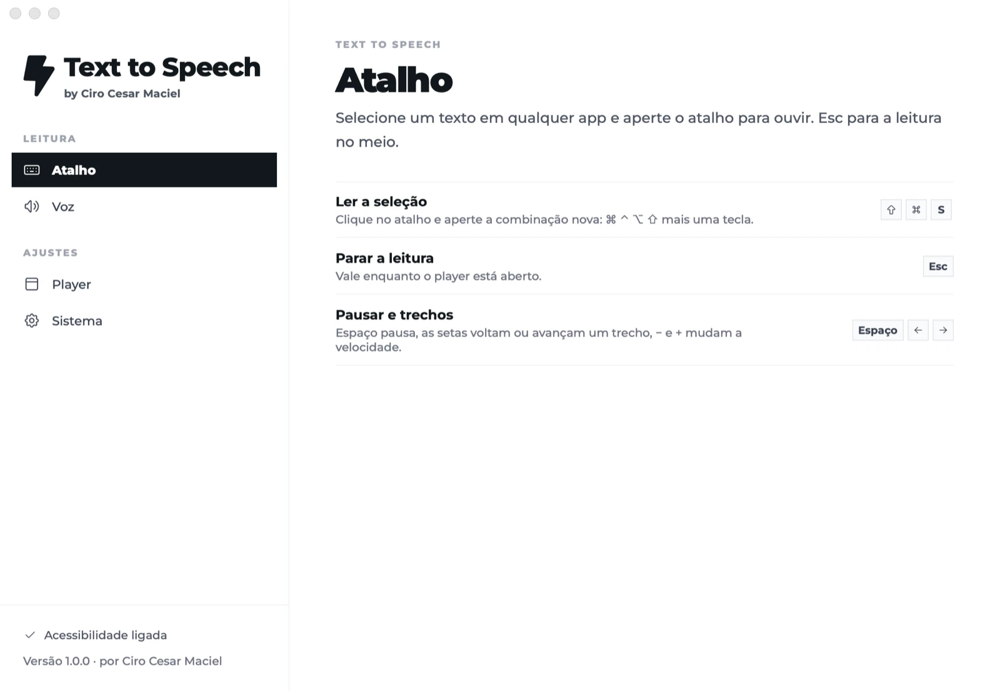

# Text to Speech by Ciro Cesar Maciel

**Selecione um texto em qualquer app do Mac, aperte um atalho e ouça o texto lido em voz alta.**

Um dos [seis apps de Mac grátis e de código aberto](#mais-de-ciro-cesar-maciel) de [Ciro Cesar Maciel](https://ciromaciel.click/?ref=oss-text-to-speech).

**[Veja o vídeo de 1 minuto](https://youtu.be/EqDHxP9jKp4)** (em inglês)

[](https://www.opensourcealternatives.to) [](https://alternativeto.net/software/text-to-speech-by-ciro-cesar-maciel/about/?utm_source=badge&utm_medium=referral)

Você escolhe quem lê: o **Davi**, do [Phonon](https://huggingface.co/gradium/phonon-40m-pt), que roda no seu Mac e não manda nada para fora depois de baixar a voz, ou o **Rafael**, do [Fish Audio](https://fish.audio), pela internet, com a sua própria chave. Um player pequeno flutua na tela, mostra a palavra sendo falada e some quando a leitura termina. Sem conta nossa e sem telemetria. Um app nativo de barra de menus, em Swift: 25 MB em disco; o Davi usa uns 170 MB de memória só enquanto gera um trecho.

[English](README.md)



## Instalar

```bash
curl -fsSL https://blob.ciromaciel.click/tools/text-to-speech/install.sh | bash
```

O script baixa o `.dmg` mais recente, copia o Text to Speech para `/Applications` e abre o app.

Prefere a imagem de disco? [Baixe o Text-to-Speech-macos.dmg](https://blob.ciromaciel.click/tools/text-to-speech/latest/Text-to-Speech-macos.dmg). Abra e arraste o Text to Speech para Aplicativos. Ele é assinado com Developer ID e notarizado pela Apple, então o macOS abre sem aviso.

O app pede uma permissão, a **Acessibilidade**: ler a seleção manda Cmd + C ao app da frente, e o macOS só deixa um app confiável fazer isso.

## Como funciona

1. Selecione um texto em qualquer lugar: um e-mail, um PDF, uma página, um documento.
2. Aperte **Cmd + Shift + S**. O app copia a seleção, devolve a sua área de transferência como estava e começa a ler.
3. Ouça. O player flutua na tela e fecha quando a leitura termina.

| Tecla | O que faz |
| --- | --- |
| Cmd + Shift + S | Ler a seleção. Dá para trocar na janela de ajustes |
| Esc | Parar |
| Espaço | Pausar e continuar |
| Seta para a esquerda / direita | Voltar ou avançar um trecho |
| - / + | Mais devagar ou mais rápido |

O texto é lido em trechos, parágrafos inteiros quando dá, para a voz manter o sentido do que lê. No Rafael, o primeiro trecho é curto, e o áudio dele toca enquanto ainda chega, então a voz começa em menos de um segundo mesmo num texto longo. O Davi fala até 150 palavras de uma vez (menos de 3 segundos para gerar no Mac), então um texto curto mantém uma só entonação do começo ao fim, no mesmo volume da voz do CCM Stack. Marcas que não são palavras (Markdown, HTML, comentários) não são lidas; um resumo `<!-- voice: ... -->` é.

## As duas vozes

A tela **Voz** mostra os passos de cada uma, com os botões que abrem as páginas certas.

**Davi, no seu Mac (Phonon).** O app traz o comando `ptts` da Gradium e roda o modelo Phonon em português do Brasil, em 4 bits. Para ligar:

1. Crie uma conta grátis em [huggingface.co](https://huggingface.co).
2. Abra a [página do modelo](https://huggingface.co/gradium/phonon-40m-pt) e peça acesso; a aprovação é automática.
3. Crie um [token do tipo Read](https://huggingface.co/settings/tokens/new?tokenType=read) e cole em **Voz**.

Na primeira leitura o app baixa a voz uma vez (58 MB). O modelo é da Gradium, com licença [CC BY-NC 4.0](https://creativecommons.org/licenses/by-nc/4.0/): uso pessoal, não comercial, que você aceita no Hugging Face. A voz Davi é do catálogo da Gradium, Apache-2.0.

**Rafael, pela internet (Fish Audio).** O app chama o Fish Audio direto, com a sua chave:

1. Crie uma conta em [fish.audio](https://fish.audio).
2. Abra as [chaves de API](https://fish.audio/app/api-keys/) e crie uma.
3. Cole a chave em **Voz**.

O modelo grátis do Fish termina em 30/11/2026; depois, o uso é cobrado pelo Fish, na sua conta.

## Privacidade: o que vai para onde

- **Davi:** o texto não sai do Mac. A única chamada de rede é o download da voz, uma vez, no Hugging Face, com o seu token.
- **Rafael:** cada trecho do texto que você selecionou, e a velocidade, vão por HTTPS direto para o Fish Audio, na sua conta, que devolve o MP3 e o tempo de cada palavra.

A chave do Fish e o token do Hugging Face ficam nas Chaves do macOS, só no seu Mac. Mais nada sai do seu Mac: a fonte da interface vem dentro do app, e não há analytics, conta nem procura de atualização.

## Compilar você mesmo

Você precisa de macOS 14 ou mais novo em Apple Silicon e das Command Line Tools do Xcode (Swift 5.10 ou mais novo).

```bash
git clone https://github.com/ciro-maciel/text-to-speech.git
cd text-to-speech
scripts/build.sh             # → dist/Text to Speech.app
scripts/check.sh             # a lógica de leitura, depois uma leitura curta em voz alta com cada voz que tiver chave
```

Sem um certificado Developer ID, o build é assinado ad hoc, então o macOS pede a Acessibilidade de novo a cada build. O `scripts/dist.sh` sobe a versão, compila, empacota o `.dmg`, manda a Apple notarizar (perfil `notary` do Keychain) e instala.

## Limites

- macOS 14 ou mais novo, em Apple Silicon.
- As duas vozes falam português do Brasil: texto em outro idioma sai com sotaque. A interface é em inglês e em português do Brasil, conforme o idioma do Mac.
- O Davi não informa o tempo de cada palavra: o destaque no player é estimado pelo tamanho do texto. O Rafael destaca a palavra exata.
- O Rafael depende do Fish Audio; quando ele está ocupado, um trecho pode falhar.
- Ainda sem atualização automática: instale a versão nova do mesmo jeito que a primeira.

## Contribuir

Issues e pull requests são bem-vindos. Veja o [CONTRIBUTING.md](CONTRIBUTING.md).

## Licença

[MIT](LICENSE). Montserrat e os ícones têm as próprias licenças: veja o [NOTICE](NOTICE).

---

## Mais de Ciro Cesar Maciel

Eu construo software sozinho, com uma equipe de agentes de IA, e abro o que dá para abrir. Seis apps nativos para Mac, todos grátis, MIT, assinados e notarizados pela Apple, em inglês e português do Brasil: [Cleaner](https://github.com/ciro-maciel/cleaner), o limpador de Mac que mostra tudo antes de apagar qualquer coisa · [Screenshots](https://github.com/ciro-maciel/screenshots), captura, anotação e gravação de tela, sem nada sair do Mac · [Speech to Text](https://github.com/ciro-maciel/speech-to-text), ditado por atalho, com o Parakeet rodando no Mac · [Assistant](https://github.com/ciro-maciel/voice-assistant), o Claude Code por voz · [Windows](https://github.com/ciro-maciel/windows), janelas no lugar com um atalho ou levando até a borda · [Text to Speech](https://github.com/ciro-maciel/text-to-speech), selecione um texto em qualquer app e ouça (este).

Além dos apps: [ferramentas grátis no navegador](https://ciromaciel.click/tools?ref=oss-text-to-speech), [livros](https://ciromaciel.click/books?ref=oss-text-to-speech) e o [Infrastructure](https://myinfrastructure.click/?ref=oss-text-to-speech), a infraestrutura que os agentes já sabem operar.

**Toda semana, por e-mail:** as [Cartas do Ciro](https://ciromaciel.click/?ref=oss-text-to-speech), o que estou construindo e aprendendo.

**Listas curadas.** [Dezenove listas awesome](https://go.mymarketing.click/oss-text-to-speech-listas) em português, traduzidas para 14 idiomas: IA no trabalho por profissão, Pix, NF-e, pagamentos, Open Finance, WhatsApp, APIs brasileiras, servidores MCP, Claude Code e mais. Cada link foi aberto antes de entrar.

**Apoie.** Tudo aqui é grátis e continua grátis. Se te poupou tempo, [pague um café](https://go.mymarketing.click/oss-text-to-speech-apoie): você escolhe o valor, por Pix ou cartão.

**Acompanhe.** [Siga @ciro-maciel](https://github.com/ciro-maciel) para os próximos apps abertos, clique em **Watch → Custom → Releases** aqui em cima para saber de cada versão nova, e veja como tudo é feito no [YouTube](https://www.youtube.com/@ciro-maciel).
