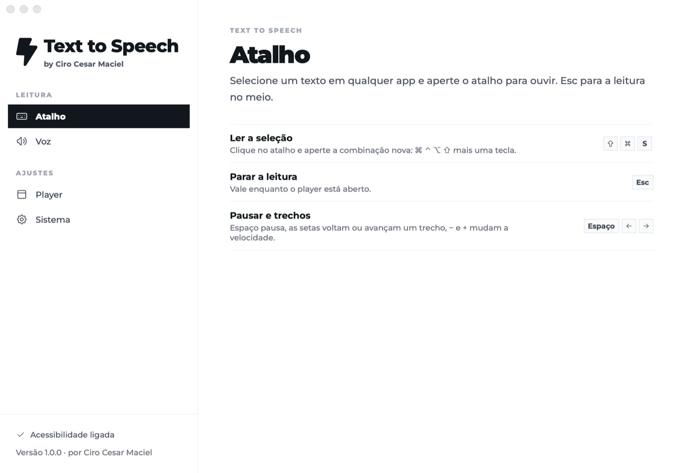

# Text to Speech by Ciro Cesar Maciel

**Selecione um texto em qualquer app do Mac, aperte um atalho e ouça o texto lido em voz alta.**

Um dos [seis apps de Mac grátis e de código aberto](#mais-de-ciro-cesar-maciel) de [Ciro Cesar Maciel](https://ciromaciel.click/?ref=oss-text-to-speech).

**[Veja o vídeo de 1 minuto](https://youtu.be/EqDHxP9jKp4)** (em inglês)

[](https://www.opensourcealternatives.to) [](https://alternativeto.net/software/text-to-speech-by-ciro-cesar-maciel/about/?utm_source=badge&utm_medium=referral)

O Rafael, uma voz natural em português do Brasil do [Fish Audio](https://fish.audio), lê pela internet e começa em menos de um segundo: o áudio toca enquanto chega. Um player pequeno flutua na tela, mostra a palavra sendo falada e some quando a leitura termina. Sem conta e sem telemetria. Um app nativo de barra de menus, em Swift: 3 MB em disco e cerca de 30 MB de memória durante a leitura.

[English](README.md)



## Instalar

```bash
curl -fsSL https://blob.ciromaciel.click/tools/text-to-speech/install.sh | bash
```

O script baixa o `.dmg` mais recente, copia o Text to Speech para `/Applications` e abre o app.

Com o [Homebrew](https://github.com/ciro-maciel/homebrew-tap): `brew install --cask ciro-maciel/tap/ciro-text-to-speech`.

Prefere a imagem de disco? [Baixe o Text-to-Speech-macos.dmg](https://blob.ciromaciel.click/tools/text-to-speech/latest/Text-to-Speech-macos.dmg). Abra e arraste o Text to Speech para Aplicativos. Ele é assinado com Developer ID e notarizado pela Apple, então o macOS abre sem aviso.

O app pede uma permissão, a **Acessibilidade**: ler a seleção manda Cmd + C ao app da frente, e o macOS só deixa um app confiável fazer isso.

## Como funciona

1. Selecione um texto em qualquer lugar: um e-mail, um PDF, uma página, um documento.
2. Aperte **Cmd + Shift + S**. O app copia a seleção, devolve a sua área de transferência como estava e começa a ler.
3. Ouça. O player flutua na tela e fecha quando a leitura termina.

| Tecla | O que faz |
| --- | --- |
| Cmd + Shift + S | Ler a seleção. Dá para trocar na janela de ajustes |
| Esc | Parar |
| Espaço | Pausar e continuar |
| Seta para a esquerda / direita | Voltar ou avançar um trecho |
| - / + | Mais devagar ou mais rápido |

O texto é lido em trechos, parágrafos inteiros quando dá, para a voz manter o sentido do que lê. O primeiro trecho é curto, e o áudio dele toca enquanto ainda chega, então a voz começa em menos de um segundo mesmo num texto longo.

## Privacidade: o que vai para onde

Cada trecho do texto que você selecionou, e a velocidade, vão por HTTPS para o servidor do Text to Speech (`manager.ciromaciel.click`, o mesmo que a página [ciromaciel.click/tools/text-to-speech](https://ciromaciel.click/tools/text-to-speech?ref=oss-text-to-speech) usa). O servidor manda para o Fish Audio, que gera o áudio, e repassa o MP3 e o tempo de cada palavra conforme chegam. O servidor não guarda o texto. O app não guarda nenhuma chave de API.

Mais nada sai do seu Mac: a fonte da interface vem dentro do app, e não há analytics, conta nem procura de atualização.

### Use o seu próprio servidor

O app chama `POST <servidor>/speak-stream` com `{ "text": "...", "speed": 1.0 }` e lê NDJSON de volta, uma linha por pedaço: `{ "audio": "<MP3 em base64>" }`, `{ "chunk": 0, "offset": 0, "words": [{ "text", "start", "end" }] }` (os tempos mais recentes de um bloco do texto, `offset` segundos dentro do trecho) e, no fim, `{ "done": true }`. Para apontar o app para um servidor seu:

```bash
defaults write click.ciromaciel.text-to-speech serverURL https://seu-servidor.exemplo/text-to-speech
```

ou defina `TEXT_TO_SPEECH_SERVER` no ambiente do app. Sem nenhum dos dois, o app usa o servidor público.

## Compilar você mesmo

Você precisa de macOS 14 ou mais novo em Apple Silicon e das Command Line Tools do Xcode (Swift 5.10 ou mais novo).

```bash
git clone https://github.com/ciro-maciel/text-to-speech.git
cd text-to-speech
scripts/build.sh             # → dist/Text to Speech.app
scripts/check.sh             # a lógica de leitura, depois uma leitura curta em voz alta pelo servidor
```

Sem um certificado Developer ID, o build é assinado ad hoc, então o macOS pede a Acessibilidade de novo a cada build. O `scripts/dist.sh` sobe a versão, compila, empacota o `.dmg`, manda a Apple notarizar (perfil `notary` do Keychain) e instala.

## Limites

- macOS 14 ou mais novo, em Apple Silicon.
- O Rafael fala português do Brasil: texto em outro idioma sai com sotaque. A interface é em inglês e em português do Brasil, conforme o idioma do Mac.
- A voz depende do servidor público e do Fish Audio; quando um deles está ocupado, um trecho pode falhar. Não há voz offline.
- Ainda sem atualização automática: instale a versão nova do mesmo jeito que a primeira.

## Contribuir

Issues e pull requests são bem-vindos. Veja o [CONTRIBUTING.md](CONTRIBUTING.md).

## Licença

[MIT](LICENSE). Montserrat e os ícones têm as próprias licenças: veja o [NOTICE](NOTICE).

---

## Mais de Ciro Cesar Maciel

Eu construo software sozinho, com uma equipe de agentes de IA, e abro o que dá para abrir. Seis apps nativos para Mac, todos grátis, MIT, assinados e notarizados pela Apple, em inglês e português do Brasil: [Cleaner](https://github.com/ciro-maciel/cleaner), o limpador de Mac que mostra tudo antes de apagar qualquer coisa · [Screenshots](https://github.com/ciro-maciel/screenshots), captura, anotação e gravação de tela, sem nada sair do Mac · [Speech to Text](https://github.com/ciro-maciel/speech-to-text), ditado por atalho, com o Parakeet rodando no Mac · [Assistant](https://github.com/ciro-maciel/voice-assistant), o Claude Code por voz · [Windows](https://github.com/ciro-maciel/windows), janelas no lugar com um atalho ou levando até a borda · [Text to Speech](https://github.com/ciro-maciel/text-to-speech), selecione um texto em qualquer app e ouça (este).

Além dos apps: [ferramentas grátis no navegador](https://ciromaciel.click/tools?ref=oss-text-to-speech), [livros](https://ciromaciel.click/books?ref=oss-text-to-speech) e o [Infrastructure](https://myinfrastructure.click/?ref=oss-text-to-speech), a infraestrutura que os agentes já sabem operar.

**Toda semana, por e-mail:** as [Cartas do Ciro](https://ciromaciel.click/?ref=oss-text-to-speech), o que estou construindo e aprendendo.

**Acompanhe.** [Siga @ciro-maciel](https://github.com/ciro-maciel) para os próximos apps abertos, clique em **Watch → Custom → Releases** aqui em cima para saber de cada versão nova, e veja como tudo é feito no [YouTube](https://www.youtube.com/@ciro-maciel).
